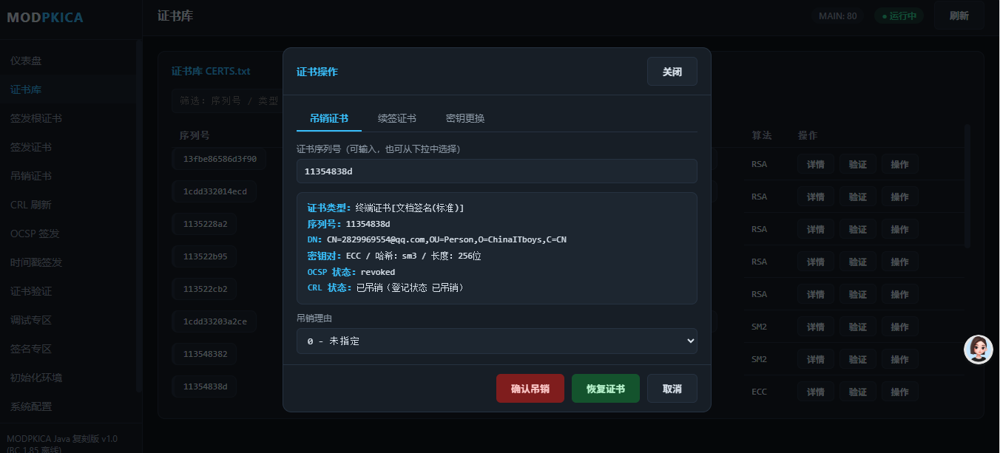
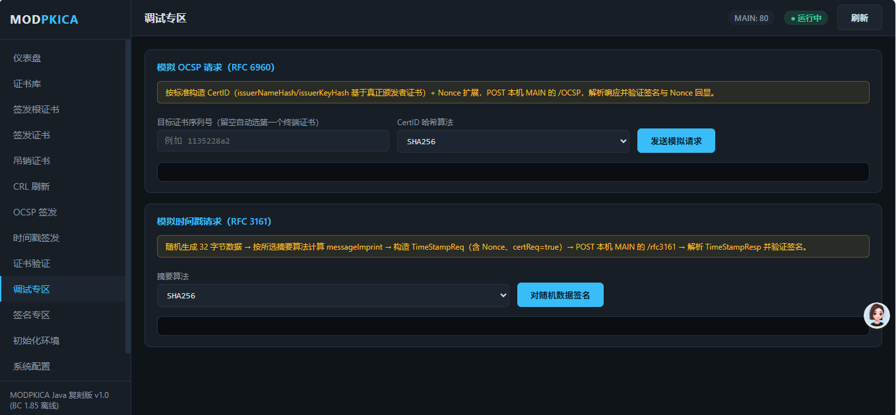
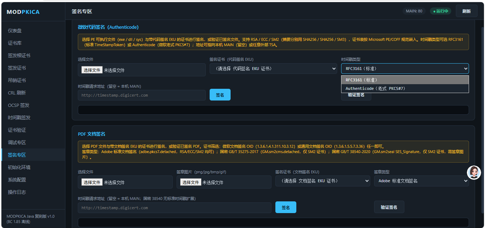
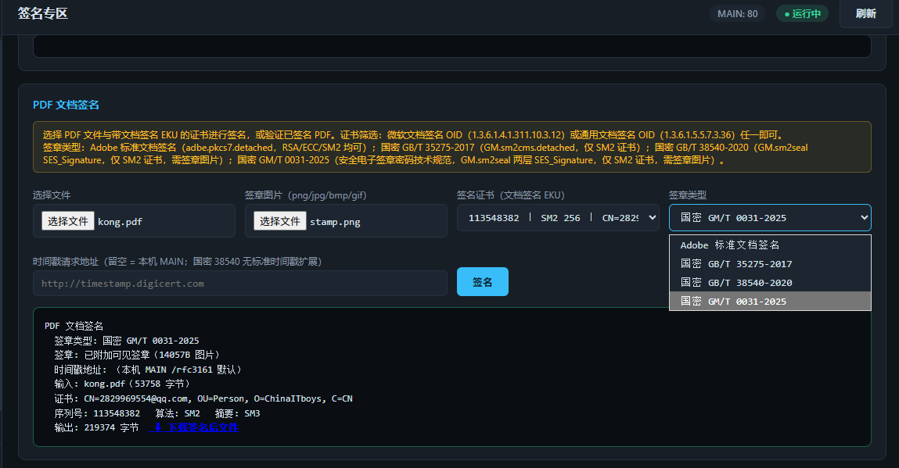

# MODPKICA Java 复刻版 v1.8（BC 1.85 离线）

> 使用 **Java + BouncyCastle 1.85** 离线复刻 Go 版 MODPKICA 全套 PKI 功能：X.509 证书签发、CRL 吊销列表、OCSP 在线状态、RFC3161 / Authenticode 时间戳、WebAdmin 浏览器管理面板。
>
> - **技术栈**：纯 `javac` 编译，无 Maven / Gradle，无网络依赖，离线可开发
> - **依赖**：`BC185/` 目录下 BouncyCastle 1.85 全家桶（bcprov / bcpkix / bcutil / bcmail）+ `lib/`（pdfbox-app-3.0.4.jar）
> - **平台**：Windows（build.cmd）/ Linux（build.sh）
> - **作者**：@魔帝本尊（QQ：2829969554）

---

## 目录

- [界面截图](#界面截图)
- [功能特性](#功能特性)
- [项目结构](#项目结构)
- [环境要求](#环境要求)
- [一键编译](#一键编译)
- [运行方式](#运行方式)
- [命令行用法（7 个主程序）](#命令行用法7-个主程序)
- [WebAdmin 管理面板](#webadmin-管理面板)
- [PKI 目录与文件说明](#pki-目录与文件说明)
- [证书类型与命名规则](#证书类型与命名规则)
- [配置文件 CONFIG.txt](#配置文件-configtxt)
- [登记表 CERTS.txt](#登记表-cerstxt)
- [操作日志 logs.log](#操作日志-logslog)
- [常见问题 FAQ](#常见问题-faq)
- [更新记录](#更新记录)

---

## 界面截图

### 仪表盘（证书链树 + 服务状态）

根 R → 中间 CA C → 终端 E 的证书链树，节点悬停显示证书参数；顶部一键刷新全部 CRL / 签发全部 OCSP / 签发全部时间戳；底部最近日志。


### 证书库（CERTS.txt 列表）

序列号 / 类型 / 状态 / 原因 / 时间 / 颁发者 ID / 算法 / 操作，支持筛选与刷新；类型中文显示（R=根证书 / C=CA证书 / E=终端证书），状态三色（V 正常绿 / R 已吊销深红 / N 未知橙）；序列号与颁发者序列号悬停显示证书简要信息；每行含详情 / 验证 / 操作三个按钮（验证弹窗按状态显示绿/红/橙标题）。


### 签发证书（参数化表单）

证书 DN（key=value 或 OID）、证书类型、密钥算法（RSA / ECC / SM2）、密钥位数（RSA 可编辑 1024~8192，ECC 只读 256/384/521，SM2 只读 256）、哈希算法、KeyUsage（下拉 + 悬浮多选组合）、EKU（编号/OID 悬浮选择器 35 项）、有效期（年数或起止日期，秒级选择）。


### 证书操作（吊销 / 续签 / 密钥更换）

证书库每行「操作」按钮弹出窗口，默认「吊销证书」分组：序列号可输入或下拉选择，显示证书简要信息（类型 / 序列号 / DN / 密钥对 / 哈希 / 长度 / OCSP 状态 / CRL 状态），选择吊销理由后确认吊销，或「恢复证书」将状态 R→V、原因置 0 并同步生成 CRL；另有「续签证书」（选择生效 / 失效时间重签）与「密钥更换」（按原算法生成新密钥对测试后重签，SKI 随新公钥更新）分组。



### 证书链详情（悬停悬浮窗）

证书链树节点悬停弹出详情：证书类型（含策略识别）、序列号、DN、密钥对 / 哈希 / 密钥长度、OCSP 状态、CRL 状态。


### 调试专区（模拟 OCSP / 时间戳请求）

按标准协议构造请求并 POST 本机 MAIN，日志逐步展示：模拟 OCSP 请求（RFC 6960，CertID 基于真正颁发者证书 + Nonce，哈希算法可选 SHA1/SHA256/SHA384/SHA512/SM3，验证响应签名与 Nonce 回显）；模拟时间戳请求（RFC 3161，随机 32 字节 → 按所选摘要算法计算 messageImprint → TimeStampReq（Nonce + certReq）→ 解析 TimeStampResp 并验证 token 签名）。



### 签名专区（微软代码签名 / PDF 文档签名）

**微软代码签名（Authenticode）**：选择 PE 可执行文件（exe / dll / sys）与带代码签名 EKU 的证书进行签名或验证，支持 RSA / ECC / SM2（摘要分别 SHA256 / SHA256 / SM3），证书表按 Microsoft PE/COFF 规范嵌入。**时间戳类型**下拉可选 **RFC3161**（标准 TimeStampToken）或 **Authenticode**（老式 PKCS#7）；**时间戳请求地址**可编辑下拉留空 = 本机 MAIN，或指向 DigiCert / Symantec / Comodo / Certum 等外部 TSA。

**PDF 文档签名**：选择 PDF 文件与带文档签名 EKU 的证书（微软文档签名 OID `1.3.6.1.4.1.311.10.3.12` 或通用文档签名 OID `1.3.6.1.5.5.7.3.36` 任一即可）。**签章类型**下拉四种：Adobe 标准文档签名（`adbe.pkcs7.detached`，RSA/ECC/SM2 均可，可选签章图片生成可见签章，**签名自动携带 RFC3161 时间戳并启用 PAdES LTV**——增量嵌入证书链 + OCSP 响应 + CRL，DSS/VRI 字典，验证器可离线长期验证）；国密 GB/T 35275-2017（`GM.sm2cms.detached`，仅 SM2 证书 + 签章图）；国密 GB/T 38540-2020（`GM.sm2seal` SES_Signature，仅 SM2 证书 + 签章图）；国密 GM/T 0031-2025（`GM.sm2seal` 两层 SES_Signature，仅 SM2 证书 + 签章图）。同样带时间戳请求地址可编辑下拉。验证支持三种类型：CMS 验签 / 文档摘要比对 / 证书链（Adobe 与 35275），SES_Signature 专用解析（dataHash 比对 + SM2 验签，自动判别 38540 四字段 / 0031 两字段）；验证输出含 LTV 状态（DSS Certs/OCSPs/CRLs/VRI 数量）。



### 签名专区（PDF 国密 GM/T 0031-2025 签章）

PDF 文档签名分组选择「国密 GM/T 0031-2025」签章类型（下拉展开示意），选择 SM2 证书与签章图片后签名，结果区展示签章类型 / 签章字节 / 时间戳地址 / 输入文件 / 证书 / 序列号 / 算法摘要 / 输出字节，并提供下载签名后文件链接。



### 操作日志（logs.log 可视化）

时间范围筛选（最近 1/6/12/24 小时、全部）、行数设置、自动刷新（3 秒）、手动刷新；每条日志含时间、时间戳、操作、命令、结果。


---

## 功能特性

### 1. MAIN —— 网络服务主程序

- **OCSP 在线证书状态协议**：`/OCSP`、`/ocsp`（POST），按请求证书序列号查 CERTS.txt 返回正常 / 已吊销 / 未知状态；支持 Nonce、按请求摘要算法自适应（SHA1/SHA256/SHA384/SHA512，SM2 固定 SM3，无摘要默认 SHA1）；未知序列号返回无签名 unauthorized 响应；用 `序列号_ocsp.crt/.key` 签署响应；SM2 分支吊销响应按 RFC 6960 标准编码（`revoked [1] IMPLICIT RevokedInfo`），openssl / BC 均可正常解析
- **CRL 吊销列表下载**：`/CRL/序列号.crl`、`/CRL/序列号.der.crl`
- **证书下载**：`/CRT/序列号.crt`
- **RFC3161 时间戳**：`/rfc3161`（文档签名专用，SHA1 / SHA256 自适应）
- **微软 Authenticode 时间戳**：`/timestamp`（SHA256）、`/timestamp/sha1`（SHA1）；请求体为 base64（容忍 CRLF / 末尾 NUL 等杂字符），响应为 PKCS#7 分离签名（eContent + signedAttrs 含 id-data 属性）
- **自适应根 TSA**：SHA1 → 随机 `rsa_sha1` / `ecc_sha1`；SHA256 → 随机 `rsa_sha256` / `ecc_sha256`；SM3/SM2 → `sm2_sm3`
- **静态网页**：`/` 提供 `PKI/WebPublic` 下文件
- **启动时自动刷新全部 CRL**
- **内嵌 WebAdmin 管理面板**（管理端口见下）

### 2. Admin —— 管理控制台（命令行）

`init` 初始化环境、`makeroot` 签发根证书、`list` 列出证书、`signcert` 签发证书、`revoke` 吊销证书、`signCRL` 刷新 CRL、`initOCSP` 签发全部 OCSP 证书、`initTIMESTAMP` 签发全部时间戳证书、`verifyCERT` 证书验证。

### 3. MakeRoot —— 签发根证书

生成 `ROOT/序列号.crt`、`ROOT/序列号.key`，同步 `WebPublic/CRT/序列号.crt`，登记 CERTS.txt（类型 R）。

### 4. MakeCert —— 签发下级证书

支持签发中间 CA（类型 C）、终端证书（类型 E）；颁发者证书类型自动从 ROOT / CA 目录加载密钥对；支持 RSA / ECC / SM2、SHA1 / SHA256 / SHA384 / SHA512 / SM3；密钥用法、增强型密钥用法（EKU 编号或 OID）、证书策略、SAN、有效期自定义。

### 5. RootGetCrl —— 签发吊销列表

遍历 CERTS.txt 中全部 R / C 证书，为每个颁发者生成独立 CRL（`WebPublic/CRL/序列号.crl`），哈希算法沿用颁发者证书（如 RSA/sha256、RSA/sha512）。

### 6. CertVerify —— 证书验证

输入证书文件或序列号，打印证书全字段（版本、序列号、签名算法、DN、有效期、公钥、SKI/AKI、EKU、SAN、AIA、CRL 分发点、KeyUsage、基本约束、证书策略、扩展、SCT）、签名验证、证书链、CRL + OCSP 吊销状态、各类哈希。

### 7. Auto —— 自动化命令

`init` 初始化环境、`revoke 序列号 原因` 吊销证书、`newcert 序列号 类型 状态 原因 时间 颁发者ID 算法` 手工登记。

### WebAdmin —— 浏览器管理面板

深色主题管理后台（13 个页面），详见下文。

---

## 项目结构

```
modpkica4JAVA/
├── BC185/                        # BouncyCastle 1.85 离线 jar 全家桶
├── lib/                          # pdfbox-app-3.0.4.jar（PDF 签名/验证）
│   ├── bcprov-jdk18on-1.85.jar   # 加密 Provider
│   ├── bcpkix-jdk18on-1.85.jar   # 证书 / CMS / TSP
│   ├── bcutil-jdk18on-1.85.jar   # ASN.1 工具
│   └── bcmail-jdk18on-1.85.jar   # 邮件 / SMIME
├── src/modpkica/                 # 全部源码（21 个类）
├── out/                          # 编译输出（javac -d out）
├── build.cmd                     # Windows 一键编译脚本
├── build.sh                      # Linux 一键编译脚本
├── PKI/                          # 运行时数据目录（MODPKICA_BASE 指向项目根时）
│   ├── ROOT/                     # 根证书（类型 R） 序列号.crt / 序列号.key
│   ├── CA/                       # 中间证书（类型 C） 序列号.crt / 序列号.key
│   ├── CERT/                     # 终端证书 PEM（类型 E） 序列号.crt
│   ├── KEY/                      # 终端证书私钥（类型 E） 序列号.key
│   ├── OCSP/                     # OCSP 签名证书 序列号_ocsp.crt / .key
│   ├── TIMSTAMP/                 # TSA 时间戳证书（类型_哈希算法.crt，如 rsa_sha256.crt）
│   ├── WebPublic/
│   │   ├── CRT/                  # 全部证书对外下载目录（序列号.crt）
│   │   └── CRL/                  # 全部 CRL 对外下载目录（序列号.crl）
│   ├── CERTS.txt                 # 证书登记表
│   ├── CONFIG.txt                # 系统配置
│   └── logs.log                  # 操作日志（只追加）
├── a.png ~ i.png                 # WebAdmin 界面截图（本文档配图）
├── README.md                     # 本文件
└── 开发助手_源码分析.pdf          # 源码结构 / 运行流程 / 常量函数速查
```

### 源码类一览（src/modpkica/）

| 类 | 职责 |
|---|---|
| `MAIN` | 主程序 1：HTTP 服务（OCSP / CRL / 时间戳 / 静态网页）+ 内嵌 WebAdmin |
| `Admin` | 主程序 2：管理控制台（doInit / doMakeRoot / doSignCert / doRevoke / doSignCrl / doInitOcsp / doInitTimestamp / doVerifyCert / doList） |
| `MakeRoot` | 主程序 3：签发根证书 |
| `MakeCert` | 主程序 4：签发下级证书（CA / 终端） |
| `RootGetCrl` | 主程序 5：生成全部 CRL |
| `CertVerify` | 主程序 6：证书验证（详情 / 签名 / 链 / 吊销 / 哈希） |
| `Auto` | 主程序 7：自动化（init / revoke / newcert） |
| `WebAdmin` | 浏览器管理面板（8080 管理端口，14 页面，26 个 API） |
| `Bc` | BC Provider 注册 |
| `PemIO` | PEM 证书 / 私钥读写、密钥类型探测 |
| `CertUtil` | 证书构建工具（SKI、扩展组装、私钥读取等） |
| `CrlUtil` | CRL 生成 / DER→PEM |
| `OcspUtil` | OCSP 请求解析 / 响应生成（含 SM2、Nonce、无签名响应） |
| `TimestampUtil` | RFC3161 与 Authenticode 时间戳（含 SM2→SM3） |
| `Sm2Util` | 国密 SM2 签名 / 验签 / SM3 / ZA 计算 |
| `SignTool` | EXE / PDF 签名与验证（Authenticode 手工 ASN.1、RFC3161/Authenticode 时间戳、Adobe 与国密 PDF 电子签章、SES_Signature 验证） |
| `CertsDB` | CERTS.txt 登记表加载 / 查询 / 刷新 |
| `Config` | CONFIG.txt 配置加载 |
| `MLog` | 追加式操作日志（时间 / 时间戳 / 操作 / 命令 / 结果） |
| `AppPaths` | 工作目录定位（环境变量 MODPKICA_BASE） |
| `AppEnv` | 可执行程序清单 |
| `X509JsonConverter` | X.509 证书 → JSON 结构化（证书库详情展示用） |

---

## 环境要求

| 项目 | 要求 |
|---|---|
| JDK | 17+（已装 JDK 17/21 均可），`javac` / `java` 在 PATH 中 |
| 依赖 | 无需联网，`BC185/`（BC 1.85 全家桶）+ `lib/`（pdfbox-app-3.0.4.jar） |
| 系统 | Windows 10/11 或 Linux（脚本分别提供 .cmd / .sh） |

---

## 一键编译

### Windows

双击 `build.cmd`，或在 cmd 中执行：

```bat
build.cmd
```

脚本流程：检查 javac → 清理 `out/` → `javac -encoding UTF-8 -cp "BC185\*;lib\*" -d out src\modpkica\*.java` → 校验 8 个 class（7 个主程序 + WebAdmin）→ 编译成功才打印运行命令提示。

**编号参数（编译后自动运行）：**

```bat
build.cmd [1-8]
```

`build.cmd` 后跟 1~8 的编号，编译**成功后**自动执行对应编号的命令；编译**失败**则跳过，不运行任何命令。编号非法（非 1-8）会在编译前直接报错退出。

| 编号 | 自动运行的命令（等价于手敲 java 命令） |
|---|---|
| `1` | `java "-Dfile.encoding=UTF-8" -cp "out;BC185\*;lib\*" modpkica.MAIN`（MAIN 服务 + WebAdmin 面板，默认 8080 端口） |
| `2` | `java "-Dfile.encoding=UTF-8" -cp "out;BC185\*;lib\*" modpkica.WebAdmin`（只开管理面板） |
| `3` | `java "-Dfile.encoding=UTF-8" -cp "out;BC185\*;lib\*" modpkica.Admin`（交互式管理控制台） |
| `4` | `java ... modpkica.MakeRoot "CN=Root,O=Org,C=CN" 2048 sha256 RSA`（签发根证书**示例参数**） |
| `5` | `java ... modpkica.MakeCert "CN=www.test.com" 2048 sha256 1 1 0 1 "www.test.com" null null root RSA`（签发证书**示例参数**） |
| `6` | `java ... modpkica.RootGetCrl`（刷新全部 CRL） |
| `7` | `java ... modpkica.CertVerify cert.crt`（验证**示例文件** cert.crt） |
| `8` | `java ... modpkica.Auto revoke 1234567890 1`（吊销**示例序列号**） |

> **注意**：编号 4/5/7/8 自动运行的是脚本内置的**固定示例参数**，不会透传额外参数（如 `build.cmd 8 revoke xxx 5` 中的 `revoke xxx 5` 会被忽略）。实际业务参数请改脚本 `:run_4`~`:run_8` 段落，或直接手敲完整 `java` 命令。

### Linux

```bash
chmod +x build.sh
./build.sh        # 只编译
./build.sh 1      # 编译成功后自动运行 MAIN（编号 1-8，与 build.cmd 完全一致）
```

> 编译成功后所有类在 `out/` 目录。

---

## 运行方式

所有主程序统一入口格式：

```bat
set MODPKICA_BASE=你的PKI根目录
java "-Dfile.encoding=UTF-8" -cp "out;BC185\*;lib\*" modpkica.主程序名 [参数...]
```

> **重要**：Windows 下必须加 `-Dfile.encoding=UTF-8`，否则中文日志 / 中文 DN 乱码（GBK 问题）。
> `MODPKICA_BASE` 缺省时取当前工作目录。示例环境为 `C:\Users\28299\Desktop\modpkica4JAVA`（PKI 目录直接位于其下）。

**运行 MAIN（推荐，WebAdmin 面板随服务自动启动）：**

```bat
set MODPKICA_BASE=C:\Users\28299\Desktop\modpkica4JAVA
java "-Dfile.encoding=UTF-8" -cp "out;BC185\*;lib\*" modpkica.MAIN
```

- WEB 服务端口：`PKI/CONFIG.txt` 的 `WEBPORT`（默认 80）
- WebAdmin 管理端口：默认 8080；可用系统属性改：`-Dmodpkica.admin.port=8082`
- 启动后浏览器访问 `http://localhost:8080`（管理面板），`http://localhost:80`（WEB 服务）

**只运行 WebAdmin（不启动 MAIN 服务）：**

```bat
java "-Dfile.encoding=UTF-8" -cp "out;BC185\*;lib\*" modpkica.WebAdmin
```

---

## 命令行用法（7 个主程序）

### Admin（管理控制台）

```bat
java "-Dfile.encoding=UTF-8" -cp "out;BC185\*;lib\*" modpkica.Admin
```

交互命令一览：

| 命令 | 说明 |
|---|---|
| `init` | 初始化环境（清空证书目录 + 重建 CERTS.txt） |
| `makeroot 证书DN 密钥位数 哈希算法 密钥算法` | 签发根证书，如 `makeroot "CN=Root,O=My Org,C=CN" 2048 sha256 RSA` |
| `list` | 列出全部登记证书 |
| `signcert 证书DN 密钥位数 哈希算法 证书类型 有效期年数 SAN类型 SAN内容 颁发者序列号 密钥算法` | 签发下级证书 |
| `revoke 序列号 原因编号` | 吊销证书（原因 0-9） |
| `signCRL` | 刷新全部 CRL |
| `initOCSP 密钥算法 [序列号]` | 为全部（或指定）R/C 证书签发 OCSP 签名证书 |
| `initTIMESTAMP 哈希算法` | 签发时间戳证书（rsa/ecc/sm2 × sha1/sha256/sm3） |
| `verifyCERT 证书文件或序列号` | 证书验证 |

### MakeRoot

```bat
java ... modpkica.MakeRoot "CN=Root,O=My Org,C=CN" 2048 sha256 RSA
```

### MakeCert

```bat
java ... modpkica.MakeCert "CN=www.test.com" 2048 sha256 1 1 0 1 "www.test.com" null null root RSA
```

### RootGetCrl

```bat
java ... modpkica.RootGetCrl
```

### CertVerify

```bat
java ... modpkica.CertVerify cert.crt        # 按文件
java ... modpkica.CertVerify 113521bfd       # 按序列号（自动去 WebPublic/CRT 查找）
```

### Auto

```bat
java ... modpkica.Auto init
java ... modpkica.Auto revoke 113521bfd 5
java ... modpkica.Auto newcert 序列号 E V 0 null 13fbe86586d1bca RSA
```

---

## WebAdmin 管理面板

启动 MAIN 或 WebAdmin 后，浏览器访问管理端口（默认 `http://localhost:8080`）。

### 页面（13 个）

| 页面 | 功能 |
|---|---|
| 仪表盘 | 服务状态、证书链树（R→C→E，悬停详情、R 展开 / C 收起管理下级）、一键刷新 CRL / 签发 OCSP / 签发时间戳、最近日志 |
| 证书库 | CERTS.txt 列表（类型中文：R=根证书 / C=CA证书 / E=终端证书；状态三色：V 正常绿 / R 已吊销深红 / N 未知橙；筛选、刷新）、序列号与颁发者序列号悬停悬浮窗、详情按钮（JSON 结构化证书信息）、验证按钮（弹窗三态：正常/已吊销/未知）、操作按钮（吊销证书 / 续签证书 / 密钥更换分组） |
| 签发根证书 | 根证书参数表单 |
| 签发证书 | 完整参数表单（DN / 类型 / 密钥算法 / 密钥位数联动 / 哈希 / KeyUsage / EKU / 有效期 / SAN） |
| 吊销证书 | 按序列号 + 原因吊销 |
| CRL 刷新 | 重新生成全部 CRL |
| OCSP 签发 | 为全部 R/C 证书签发 OCSP 签名证书 |
| 时间戳签发 | 签发时间戳证书 |
| 证书验证 | 输入证书文件或序列号验证（证书策略识别含 SSL/代码签名/文档签名/TSA 等 OID） |
| 初始化环境 | 清空重建（不会执行重置类脚本，由 WEB 面板提供） |
| 系统配置 | 可视化读写 CONFIG.txt（WEBPORT / OCSP / CRL / CRT / CPS / CPS_Nonice 多行文本） |
| 操作日志 | logs.log 时间范围筛选 + 自动刷新 |
| 调试专区 | 模拟 OCSP 请求（RFC 6960，CertID+Nonce，哈希算法可选 SHA1/256/384/512/SM3，验证响应签名与 Nonce 回显）+ 模拟时间戳请求（RFC 3161，随机数据按所选摘要算法构造 TimeStampReq，解析并验证 token 签名） |
| 签名专区 | EXE 代码签名（时间戳类型 RFC3161/Authenticode + 时间戳地址可编辑下拉）+ PDF 文档签名（签章类型 Adobe/国密 35275/国密 38540/国密 0031 + 时间戳地址可编辑下拉），均含签名与验证 |

### API（26 个）

`/api/status`、`/api/certs`、`/api/logs`、`/api/config`、`/api/chain`、`/api/certjson`、`/api/version`、`/api/issuers`、`/api/init`、`/api/makeroot`、`/api/signcert`、`/api/revoke`、`/api/restore`、`/api/rekey`、`/api/renew`、`/api/crl`、`/api/initocsp`、`/api/inittimestamp`、`/api/verify`、`/api/signcerts?kind=exe|pdf`（GET）、`/api/sign/exe`、`/api/sign/pdf`、`/api/verify/exe`、`/api/verify/pdf`、`/api/debug/ocsp`、`/api/debug/tsa`

---

## PKI 目录与文件说明

| 路径 | 内容 |
|---|---|
| `PKI/ROOT/` | 根证书：`序列号.crt` + `序列号.key` |
| `PKI/CA/` | 中间证书：`序列号.crt` + `序列号.key` |
| `PKI/CERT/` | 终端证书 PEM：`序列号.crt` |
| `PKI/KEY/` | 终端证书私钥：`序列号.key` |
| `PKI/OCSP/` | OCSP 签名证书：`序列号_ocsp.crt` + `序列号_ocsp.key` |
| `PKI/TIMSTAMP/` | TSA 证书：`类型_哈希算法.crt`（rsa_sha1 / rsa_sha256 / ecc_sha1 / ecc_sha256 / sm2_sm3）+ `.key` |
| `PKI/WebPublic/CRT/` | 全部证书对外下载：`序列号.crt` |
| `PKI/WebPublic/CRL/` | 全部 CRL 对外下载：`序列号.crl`、`序列号.der.crl` |
| `PKI/CERTS.txt` | 证书登记表 |
| `PKI/CONFIG.txt` | 系统配置 |
| `PKI/logs.log` | 操作日志 |

---

## 证书类型与命名规则

| 类型 | 含义 | 密钥存储 | 对外 |
|---|---|---|---|
| `R` | 根证书 | `ROOT/序列号.crt`、`ROOT/序列号.key` | `WebPublic/CRT/序列号.crt` |
| `C` | 中间证书 | `CA/序列号.crt`、`CA/序列号.key` | `WebPublic/CRT/序列号.crt` |
| `E` | 终端证书 | `CERT/序列号.crt`、`KEY/序列号.key` | `WebPublic/CRT/序列号.crt` |
| OCSP 专用 | OCSP 签名 | `OCSP/序列号_ocsp.crt`、`_ocsp.key` | `WebPublic/CRT/序列号.crt` |
| TSA 专用 | 时间戳签名 | `TIMSTAMP/类型_哈希.crt/.key` | `WebPublic/CRT/序列号.crt` |

> 所有证书签发后同时按 `序列号.crt` 同步到 `WebPublic/CRT/`，供 `/CRT/{CID}.crt` 下载。

---

## 配置文件 CONFIG.txt

位于 `PKI/CONFIG.txt`，无文件时 WebAdmin 系统配置页会自动创建默认内容：

```ini
WEBPORT=80
OCSP=http://localhost:80/OCSP
CRL=http://localhost:80/CRL/{CID}.crl
CRT=http://localhost:80/CRT/{CID}.crt
CPS=https://gitee.com/wxgshuju/modpkica
CPS_Nonice=http://example.com/nonice
```

- `WEBPORT`：WEB 服务监听端口（默认 80）
- `OCSP` / `CRL` / `CRT`：写入证书 AIA / CRL 分发点的 URL，支持 `{CID}` 占位符（替换为证书序列号）
- `CPS`：证书策略 CPS URI
- `CPS_Nonice`：证书策略用户通告（UserNotice）文本；WEB 面板多行输入，保存时换行以 `\n` 存储，签发证书时 `\n` 还原为真实换行

---

## 登记表 CERTS.txt

位于 `PKI/CERTS.txt`，每行一条，空白分隔：

```
序列号 类型 状态 原因编号 签发/吊销时间 颁发者序列号 密钥算法
```

示例：

```
13fbe86586d1bca R V 0 2026/09/08-23:18:34 13fbe86586d1bca RSA
113521bfd E R 5 2026/09/09-00:53:25 1cdd332012fa2 RSA
```

- 类型：`R` 根 / `C` 中间 / `E` 终端
- 状态：`V` 正常 / `R` 已吊销 / `N` 未知
- 原因编号：0-9（吊销原因）
- 时间格式：`yyyy/MM/dd-HH:mm:ss`

> MAIN 在 OCSP / 时间戳处理前会重新加载 CERTS.txt，外部修改即时生效（无需重启）。

---

## 操作日志 logs.log

位于 `PKI/logs.log`，**只追加**，每条记录包含：时间、时间戳、操作、命令、结果，记录间以**两个换行**分隔。所有操作（Admin 命令、WEB 请求、CRT/CRL/OCSP/时间戳请求、签名、摘要、验签过程）都会写入。

---

## 常见问题 FAQ

**Q1：编译/运行时中文乱码？**
A：必须带 `-Dfile.encoding=UTF-8` 运行；源码编译已用 `-encoding UTF-8`。脚本注释使用英文避免 cmd 代码页问题。

**Q2：`Address already in use: bind`？**
A：WEB 端口（默认 80）被占用。先 `netstat -ano | findstr :80` 找到 PID 结束旧进程，或改 `CONFIG.txt` 的 `WEBPORT`。

**Q3：OCSP 报"未知序列号"？**
A：确认 CERTS.txt 有记录、`WebPublic/CRT/序列号.crt` 存在、`OCSP/颁发者序列号_ocsp.crt` 已生成（先运行 `initOCSP`）。

**Q4：Wosign 代码签名选 RFC3161 时间戳失败？**
A：RFC3161 时间戳用于 PDF 文档签名；微软代码签名请选 **Authenticode** 类型（`/timestamp` 或 `/timestamp/sha1`）。

**Q5：签发 ECC 证书报错？**
A：确认密钥位数按 ECC 曲线选择（256/384/521），且 BC 1.85 的 `BC185/` 完整放入项目根。

**Q6：SM2 已吊销证书 OCSP 验证报 `OCSP无法检查吊销状态 | 上报失败~`？**
A：v1.1 已修复。根因是 SM2 分支手动 ASN.1 编码 `CertStatus.revoked` 误用 EXPLICIT，RFC 6960 要求 `[1] IMPLICIT RevokedInfo`，导致 openssl / BC 解析错位（`wrong tag` / `illegal object`）。RSA / ECC 已吊销证书不受影响（走 BC 高层 API）。升级后重启 MAIN 生效。

**Q7：如何离线开发？**
A：所有依赖只有 `BC185/` 全家桶 + `lib/`（pdfbox），无 Maven 仓库；源码改完直接 `build.cmd` 编译，`out/` 即产物。

**Q8：国密 PDF 签章（35275 / 38540 / 0031）报错？**
A：三者都**必须**使用 SM2 证书，且**必须**选择签章图片（png/jpg/bmp/gif）。GB/T 38540-2020 与 GM/T 0031-2025（`GM.sm2seal`）无标准时间戳扩展，即使填了时间戳地址也不嵌入；GB/T 35275-2017（`GM.sm2cms.detached`）为 CMS 结构可正常验签（SM3withSM2 含 ZA）。若用非 SM2 证书或未选图片，面板会给出明确中文错误。

**Q9：签名时时间戳地址填了外网 TSA 但失败？**
A：离线 / 无外网环境会请求失败，但签名**不中断**——时间戳失败自动降级（日志记录原因），文件照常签名成功。连接外部 TSA 需本机可访问其 80/443 端口；留空则使用本机 MAIN 时间戳服务。

---

## 更新记录

- **v1.8（2026-09-15）——PDF Adobe 标准签名携带 RFC3161 时间戳 + PAdES LTV 长期验证**
  - **时间戳嵌入修复**：此前 PDF Adobe 标准签名在时间戳地址留空（= 本机 MAIN）时**不携带时间戳**——根因 `buildCms` 以 `tsUrl != null && !tsUrl.trim().isEmpty()` 作为嵌入条件，WebAdmin 留空传 `""` 被误判为"不嵌"。修复：非 null（含空串）即请求本机 MAIN `/rfc3161`，RFC3161 时间戳 token 以 `id-aa-timeStampToken`（1.2.840.113549.1.9.16.2.14）嵌入 signedAttrs；**时间戳请求失败自动降级**（不带时间戳继续签名，原因写入 logs.log，与 EXE 行为一致）
  - **新增 PAdES LTV 长期验证**（`SignTool.applyLtvPdf`）：签名完成后自动增量追加 **DSS（Document Security Store）+ VRI** 字典，使验证器可离线长期验证（Acrobat 显示"签名有效，已启用 LTV"）：
    - **DSS/Certs**：签名证书链 DER（去重）
    - **DSS/OCSPs**：链上每张证书的 OCSP 响应（RFC 6960 完整 OCSPResp，含响应者签名；CertID=SHA-1 的 issuerNameHash/issuerKeyHash + 序列号 + Nonce 扩展；请求地址 = CONFIG.txt `OCSP`，缺省 `http://127.0.0.1:WEBPORT/OCSP`）
    - **DSS/CRLs**：链上每个 CA/根的 CRL（DER；优先 CONFIG.txt `CRL` URL 替换 `{CID}` 后的 `.der.crl` 变体，回退原 URL 与本地 `PKI/WebPublic/CRL/序列号.der.crl`）
    - **VRI**：key = ByteRange 覆盖内容 **SHA-1 十六进制大写**（PAdES 规定，兼容 Acrobat）；引用 DSS 中对应 OCSP/CRL/Cert 数组
    - 所有 LTV 对象为新增间接对象 + catalog `/DSS` 增量修订，**PDFBox `saveIncremental(out, updated)` 增量保存，不触碰原签名区（ByteRange 不变，原签名保持有效）**
    - 任一采集失败（MAIN 未启动 / 外网不可达 / 本地无 CRL）自动跳过对应数据，不影响签名
  - `verifyPdf` 增加 **LTV 状态输出**：`LTV: 已启用（DSS 字典，Certs=n，OCSPs=n，CRLs=n，VRI=<SHA1 hex>）` 或 `LTV: 未启用（无 DSS 字典）`
  - **实测（1135228a2 RSA，链 EVCA→ROOTCA）**：签名产物 DSS Certs=3 / OCSPs=3 / CRLs=2、VRI key 正确；OCSP[0] `responseStatus=0`（successful）、CRL[0] 颁发者=EVCA 条目=5 均可解析；CMS 验签、文档摘要比对（SHA-256）、证书链三级验证全部通过；`id-aa-timeStampToken` 属性确认已嵌入（1 个 token）

- **v1.7（2026-09-15）——PDF 签名专区新增第四种签章类型：国密 GM/T 0031-2025《安全电子签章密码技术规范》**
  - **标准澄清**：需求中"GB/T 0031-2025"实际为 **GM/T 0031-2025**（密码行业标准，非 GB/T 国标；国家密码管理局公告第 54 号发布，2026-07-01 实施，替代 GM/T 0031-2014）。2025 版全文未公开（行业标准不免费发布），实现依据 = **GM/T 0031-2014 官方标准原文**（gmbz.org.cn）公开的 ASN.1 + 2025 版公告确认的兼容演进，交付如需对拍正式文本以官方为准
  - **与 GB/T 38540-2020 的结构差异**（August 技术博客 + 2014 官方原文交叉确认）：
    | 层次 | GB/T 38540-2020 | GM/T 0031 |
    |---|---|---|
    | 电子印章 SESeal | { eSealInfo, **cert, signAlgID, signedValue** } 4 子节点 | { SES_SealInfo, **SES_SignInfo{cert, signatureAlgorithm, signData}** } 2 子节点 |
    | 印章属性 | { type, name, **certListType**, certList(证书 DER), ... } | { type, name, certList(SEQUENCE OF **certID=IA5String 证书序列号**), ... }，无 certListType |
    | 电子签章 SES_Signature | { TBS_Sign, cert, signatureAlgID, signature } 4 子节点 | { TBS_Sign, signature } 2 子节点 |
    | TBS_Sign | { version, eseal, timeInfo(GeneralizedTime), dataHash, propertyInfo } 5 字段 | { version, eseal, timeInfo(**BIT STRING**，时间戳或 UTCTIME), dataHash, propertyInfo, **cert, signatureAlgorithm** } 7 字段 |
    | 判别法 | 签章第 2 子节点 OCTET STRING；印章 4 子节点 | 签章第 2 子节点 BIT STRING；印章 2 子节点 |
    | 制章签名对象 | SES_SealInfo 本体 | SEQUENCE{ SES_SealInfo, cert, signatureAlgorithm } |
  - **新增构造器**：`buildGmSealInfo0031`（SES_SealInfo：header{ID="ES",version=11,Vid="MODPKICA"} / esID / property{type=1,name,certList 三项证书序列号,createDate/validStart/validEnd=UTCTIME} / picture / extDatas 政务 OID）；`buildGm0031Signature`（SES_Signature：SESeal 两层嵌套 → TBS_Sign 7 字段 → SM2 对 TBS_Sign 完整 DER 签名）；`signPdfGm` 三路分发（38540/0031/35275），0031 的制章签名单独按 SEQUENCE{SealInfo,cert,OID} 计算；`signPdf` 入口白名单加入 `GM0031`
  - **PDF 集成**：Filter=`Adobe.SM2`、**SubFilter=`GM.sm2seal`**（GM/T 0112-2021《PDF 格式文档的密码应用技术要求》规定的国密电子签章子过滤器，与 38540 共用，验证端按签章子节点类型自动判别 38540/0031）、DM/SM 属性=SM3/SM2 OID、Contents=SES_Signature DER 十六进制；时间戳按 GM/T 0112 建议附签章尾部，本实现 timeInfo 内嵌 UTCTIME（签章时间），外部时间戳扩展沿用现有"仅 ADOBE/GM35275 嵌入"规则
  - **验证侧**：`verifyGmSeal38540` 升级为判别式——SES_Signature 4 子节点走 38540 分支（证书/算法在【外层】），2 子节点走 0031 分支（证书/算法在【TBS_Sign 内部】tbs[5]/tbs[6]），两者 dataHash 均取 TBS_Sign[3] 与 SM3(ByteRange) 比对 + 证书公钥 SM3withSM2 验签 TBS_Sign 完整 DER
  - **实测（113548382 SM2 证书，链 SM2CA→ROOTCA）**：`sealType=GM0031` 签名 → 产物 SubFilter=GM.sm2seal、SES_Signature 2 子节点、TBS_Sign 7 字段、SESeal 2 子节点、certList 三项证书序列号（113548382/1cdd33203a2ce/13fbe86586d3f90）、version=4、header version=11；验证接口输出「TBS_Sign 字段数: 7」「文档摘要比对: 通过 ✓」「SM2 签名验证: 通过 ✓」「最终结论: 国密 PDF 电子签章有效 ✓」；GM38540（5 字段）与 GM35275（CMS）回归均通过
  - WebAdmin：PDF 组「签章类型」下拉新增 `国密 GM/T 0031-2025`；`sealLabel` 四路映射；hint 说明更新；签章仅限 SM2 证书且必须选择签章图片

- **v1.6（2026-09-15）——Authenticode 时间戳嵌入方式修复 + 国密 PDF 签名空间修复**
  - **国密 PDF 签名空间修复**：GB/T 35275-2017 与 GB/T 38540-2020 签名时若印章图片较大（> ~55KB），签名 Contents（印章图片字节 + 证书链 + ASN.1 结构）会超过固定预留的 65536 字节，触发 `java.io.IOException: Can't write signature, not enough space`。修复：`signPdfGm` 按实际输入**动态计算预留空间**（`pref = max(65536, 图片字节+证书链+8192) × 1.5 + 32768`）。实测 2MB 印章图两种国密标准均签名成功（输出 8.4MB 增量 PDF）；小图场景不变（最小仍 64KB）
  - **问题**：签名专区选择「Authenticode」时间戳时，签名操作本身成功（日志显示"已附加 Authenticode 时间戳"），但 Windows 原生验证失败：`signtool verify /pa /v` 报 `0x80091004`（File is not timestamped）→ 修复后进一步暴露 `0x80096003`（BAD_DIGEST），两者根因不同：
    - **0x80091004 根因**：旧实现把 RFC3161 的 `SPC_RFC3161_TS`（`1.3.6.1.4.1.311.3.3.1`）属性嵌入完整 ContentInfo，Windows 只认老式 **countersignature（`1.2.840.113549.1.9.6`）** 机制。用 signtool 自身产物 asn1parse 对照确认：老式时间戳 = unsignedAttrs 中 `countersignature` 属性，其值为 token 内**首个 SignerInfo**（不是完整 token）
    - **0x80096003 根因**：countersignature 的签名需要 **TSA 证书**参与验证，但主 CMS 证书集合只放了签名证书链，未并入 token 内的 TSA 证书（signtool 会合并）→ 修复：`extractCertificates` 从 token `SignedData` 提取证书（注意 `certificates` 为 **IMPLICIT [0]**，需 `ASN1Set.getInstance(tagged, false)`），按序列号去重后并入主 CMS 证书集合
  - **请求侧对齐**：新增 `SignTool.requestAuthenticodeTimestamp(sig, baseDir, tsUrl)`——请求体 = base64( `ContentInfo{1.3.6.1.4.1.311.3.2.1, SEQUENCE{id-data, [0] OCTET STRING(主签名值)}}` )，与 signtool `/t` 及 Go 版 MAIN `/timestamp` 提取协议（0x04 0x81/82/83 定位被签名内容）完全一致；响应兼容 DER 直返与 base64 PEM 正文两种
  - **嵌入侧**：`buildExeCms` 对 AUTHENTICODE 类型走 countersignature 分支（提取 token 首个 SignerInfo 嵌入 `1.2.840.113549.1.9.6`），RFC3161 仍走 `SPC_RFC3161_TS` 完整 token 分支，互不影响
  - **实测（Windows 原生）**：两种模式均 `signtool verify /pa /v` → 0 错误，`The signature is timestamped`，`Timestamp Verified by ROOTCA By Timstamp SHA256`；Authenticode 产物 asn1parse 与 signtool 自身产物逐字段一致（signedAttrs 含 contentType / signingTime / CMSAlgorithmProtection / messageDigest=SHA256(主签名值) / id-data=主签名值）
  - **说明**：外部 TSA（DigiCert 等）选择 Authenticode 类型时，若其响应为 `TimeStampResp`（PKIStatus 包装）或直接 `ContentInfo`，`extractFirstSignerInfo` 均兼容；请求失败自动降级不影响主签名

- **v1.5（2026-09-15）——签名专区：时间戳类型 / 签章类型 / 国密 PDF 电子签章**
  - **EXE 代码签名组新增「时间戳类型」下拉**（RFC3161 / Authenticode）：RFC3161 → 标准 TimeStampToken（POST `application/timestamp-query`，默认本机 MAIN `/rfc3161`）；Authenticode → 微软老式 PKCS#7（请求体 base64 文本，默认本机 MAIN `/timestamp`）。`SignTool.requestTimestamp` 增加类型/地址重载：Authenticode 响应兼容 DER 直接返回与 base64 PEM 正文（本机 MAIN 按 Go 版返回 PKCS#7 DER 的 base64，需解码后再嵌入 unsignedAttrs `1.3.6.1.4.1.311.3.3.1`）
  - **EXE / PDF 两组新增「时间戳请求地址」可编辑下拉**：留空 = 本机 MAIN（WEBPORT 读 CONFIG.txt）；内置 DigiCert / Symantec / Comodo / Certum 四个外部 TSA 快捷选项，可手输任意地址。实测连接 `http://timestamp.digicert.com` 成功获取真实 RFC3161 时间戳（5986B）并嵌入；请求失败自动降级（签名成功、日志记录原因）
  - **PDF 组新增「签章类型」下拉**（三种）：
    - **Adobe 标准文档签名**（默认，`adbe.pkcs7.detached`）：支持 RSA / ECC / SM2；`buildCms` 经 `DefaultSignedAttributeTableGenerator` 在 signedAttrs 附加 `id-aa-timeStampToken`（`1.2.840.113549.1.9.16.2.14`，值为 RFC3161 时间戳令牌），BC 自动补 contentType / messageDigest；实测 CMS 验签、文档摘要比对、证书链全部通过
    - **国密 GB/T 35275-2017**（`GM.sm2cms.detached`，仅 SM2 证书）：Contents 为标准 CMS SignedData（detached），SESeal 电子印章挂 signedAttrs 私有 OID `1.2.156.112600.8.1`（eSealInfo + 印章证书链块 + SM2 OID + 制章签名）；Filter=`Adobe.SM2`、DM/SM 属性=SM3/SM2 OID；证书链完整写入 CMS certificates；实测 CMS 验签（SM3withSM2 含 ZA）、文档摘要比对、证书链通过
    - **国密 GB/T 38540-2020**（`GM.sm2seal`，仅 SM2 证书，必须选签章图片）：Contents 手工 ASN.1 构造 **SES_Signature**（SEQUENCE{ toSign TBS_Sign, cert, signatureAlgID=SM2 OID, signature }）；TBS_Sign=SEQUENCE{ version=4, eseal SESeal, GeneralizedTime, dataHash=SM3(ByteRange), propertyInfo }；SESeal=eSealInfo（header/esID/property 含证书列表与有效期/picture/extDatas 政务 OID）+ 制章证书 + SM2 OID + 制章签名；`setPreferredSignatureSize(65536)` 预留大签名区；验证新增 `verifyGmSeal38540` 专用解析：dataHash 与 SM3(ByteRange) 比对 + 证书公钥 SM3withSM2 验签 TBS_Sign 完整 DER，实测两项全部通过
  - 国密 PDF 印章信息构建：`buildGmSealInfo38540`（SES_SealInfo 五段）/ `buildGmSealInfo35275`（sealId/UUID/certInfo/imgInfo/ext），制章签名与文档签名均走 `Signature.getInstance("SM3WITHSM2","BC")`（BC 内置 ZA 计算，符合 GB/T 32918）；参考实现：`java-lening\PDF或者OFD国密SM2签名验证\多个版本\PDF国密GBT 38540-2020（4）` 与 `PDF国密SM2公安政务兼容GBT 35275-2017（2）`
  - WebAdmin `signAction` 读取并传递 `tsType` / `tsUrl` / `sealType`，日志与 `lastTsInfo` 完整展示类型与地址；`signDo` JS 追加对应 FormData 字段；PDF 组国密模式（35275/38540）下选择非 SM2 证书与未选签章图片时给出明确中文报错

- **v1.4（2026-09-15）——签名专区修复与增强**
  - **微软代码签名（Authenticode）重写**：`SignTool.signExe` 改为手工 ASN.1 构造（对齐参考项目 `java-lening\微软RSA国密双签名带时间戳` 的合规点），修复旧实现（BC `CMSSignedDataGenerator` 自动构造）产物被 Windows 判 `0x80096010 / 签名无效` 的问题：
    - `SpcAttributeTypeAndOptionalValue.value` 直接 SEQUENCE（无 `[0]` 包装）；`SpcPeImageData.file` 实际标签 `[0] EXPLICIT`；`SpcString` 空串 `[0] IMPLICIT 80 00`；`DigestInfo.digestAlgorithm.parameters` 带 `NULL`；eContent 直接 SEQUENCE（无 OCTET STRING 包装）；messageDigest = SHA-256(SpcIndirectData **内容字节**，跳过 `30 xx` 头)；证书表 8 字节对齐追加 `WIN_CERTIFICATE 0x0200/0x0002`；证书顺序根在前
    - **自动时间戳**：签名后 `messageImprint = SHA-256(签名值)` → 请求本机 MAIN `/rfc3161`（`application/timestamp-query`，WEBPORT 读 `PKI/CONFIG.txt`）→ `TimeStampToken` 嵌入 unsignedAttrs（`1.3.6.1.4.1.311.3.3.1`）；失败自动降级不影响签名，状态写入日志
    - **实测（Windows 原生）**：`signtool verify /pa /v` → 0 错误、时间戳验证通过；`Get-AuthenticodeSignature` → **Valid**（证书链 ROOTCA→终端、时间戳 ROOTCA By Timstamp SHA256）
    - **已知限制**：中间 CA 若 EKU 仅含 serverAuth（不含代码签名），Windows Authenticode 链验证会拒绝该 CA 签发的证书用于代码签名（`signing certificate is not valid for the requested usage`）——根直接签发的代码签名证书不受影响；如需使用中间 CA 链，请重签 CA 时在 EKU 中加入代码签名或不设 EKU
    - SM2 主签名 EXE：签名与时间戳正常生成；Windows crypt32 白名单不含 SM2，原生验证不支持（与参考项目结论一致），可用本面板"签名验证"做链内验证
  - **PDF 可见签章**：PDF 分组新增"签章图片（可选，png/jpg/bmp/gif）"选择框；采用参考项目 `SignatureOptions.setVisualSignature` 外观文档模式（独立外观 PDF 内放置带 Rect+AP 的 widget，PDFBox 将 Rect/外观搬至主文档第 1 页右下角，最大 150×80 等比缩放），**避免 addSignature 后改动文档破坏 ByteRange**（替代早期 PDSignatureField 手动方式，后者报 `signature reserve byte range has been changed`）；不选签章则不可见签名
  - 实测：`test.pdf`（5 页）带签章签名 → `CMS 签名验证通过`、文档摘要比对通过、证书链通过，第 1 页右下角签章渲染可见；无签章 PDF 签名回归通过；SM2 证书 EXE 签名回归通过

- **v1.3（2026-09-15）**
  - WebAdmin 新增「签名专区」页面（调试专区下方）：两个分组均支持选择文件 + 下拉式证书选择（自动按 EKU 筛选、悬停显示证书简介）
    - **微软代码签名（Authenticode）**：对 exe/dll/sys 等 PE 文件按 Microsoft PE/COFF 规范嵌入证书表（WIN_CERTIFICATE 0x0200/0x0002 + CMS SignedData，contentType=spcIndirectDataContext，SpcIndirectDataContent 内含 Authenticode 文件哈希：跳过 Checksum/Security Directory/证书表区域），支持 RSA/ECC/SM2（SM2 走 GB/T 32918 含 ZA，摘要 SM3；RSA/ECC 摘要 SHA256）；验证输出 CMS 签名、文件哈希比对、证书链逐级验证（签名证书 → 颁发者 → 自签根）三要素
    - **PDF 文档签名**：标准 PKCS#7 detached（SubFilter adbe.pkcs7.detached），基于 PDFBox 3.0.4 外部签名两段式（saveIncrementalForExternalSigning）增量保存，ByteRange 由 PDFBox 维护；验证时以 ByteRange 区间数据作为 detached 内容构造 CMS 后验签（否则 BC 按空内容计算摘要导致 mismatch），同样支持 RSA/ECC/SM2
  - 新增 `SignTool.java`（签名/验证核心，约 35KB）：按 CERTS.txt 台账加载证书（R→ROOT、C→CA、E→CERT）与私钥（E→KEY），按颁发者关系加载完整证书链；EKU 筛选集合：代码签名 `1.3.6.1.5.5.7.3.3` / 内核模式 `1.3.6.1.4.1.311.61.1.1` / 驱动验证 `1.3.6.1.4.1.311.10.3.5` / 系统组件 `1.3.6.1.4.1.311.10.3.6` / OEM `1.3.6.1.4.1.311.10.3.7` / 内嵌 `1.3.6.1.4.1.311.10.3.8`，文档签名 `1.3.6.1.4.1.311.10.3.12` / 通用文档签名 `1.3.6.1.5.5.7.3.36`（代码签名证书亦可签 PDF）
  - WebAdmin 新增 API：`GET /api/signcerts?kind=exe|pdf`（可签名证书列表）、`POST /api/sign/exe`、`POST /api/sign/pdf`（multipart 上传文件 + serial，返回签名结果 + Base64 下载）、`POST /api/verify/exe`、`POST /api/verify/pdf`；所有签名/验证操作写入 logs.log
  - 依赖：`lib/pdfbox-app-3.0.4.jar`（PDFBox 3.0.4，从参考项目引入）；`build.cmd` / `build.sh` 编译与运行 classpath 均加入 `lib\*`（`-cp "BC185\*;lib\*"` / `"out;BC185\*;lib\*"`）
  - 实测（真实样本）：`CERTVERIFY.exe`（9.8MB）Authenticode 签名/验证三要素全部通过；`test.pdf`（5 页）与 SM2 证书 PDF 签名/验证全部通过（SM3 摘要、SM3withSM2 含 ZA 验签成功）

- **v1.2（2026-09-14）**
  - WebAdmin 新增「调试专区」页面：两个分组均按标准协议构造请求并 POST 本机 MAIN，日志逐步展示
    - **模拟 OCSP 请求（RFC 6960）**：按 CertID（issuerNameHash/issuerKeyHash 基于真正颁发者证书计算，哈希算法可选 SHA1/SHA256/SHA384/SHA512/SM3）+ Nonce 扩展构造请求 → 解析响应（responseStatus、responderID、证书状态/吊销原因时间、thisUpdate/nextUpdate、Nonce 回显比对）→ 用响应者证书验证签名
    - **模拟时间戳请求（RFC 3161）**：随机 32 字节数据 → 按所选摘要算法（SHA1/SHA256/SHA384/SHA512/SM3）计算 messageImprint → 构造 TimeStampReq（Nonce + certReq）→ 解析 TimeStampResp（status、TimeStampToken 序列号/genTime/policy、messageImprint 回显比对）→ 用签名者证书验证 token 签名；MAIN 返回非 200 时显示真实错误与所需 TSA 证书提示
  - OCSP 服务端行为（RFC 6960）：解析请求哈希算法 OID 与序列号 → 按 `颁发者序列号_ocsp.crt/.key` 加载响应者密钥对；RSA/ECC 按请求哈希算法（sha1/256/384/512，缺省 sha1）签名，SM2 固定 SM3 签名（`MAIN.handleOcsp` + `OcspUtil`，此前已实现，本轮以调试专区实测 Nonce 回显与签名验证通过）

- **v1.1（2026-09-13）**
  - 修复 SM2 分支 OCSP 吊销响应的 DER 编码错误：`CertStatus.revoked` 由 EXPLICIT 改为 RFC 6960 规定的 `[1] IMPLICIT RevokedInfo`（`OcspUtil.createResponseSm2`）。此前 openssl 解析报 `Field=revocationTime ... wrong tag`、BC 报 `illegal object in getInstance`，表现为 SM2 已吊销证书（含重复吊销/修改吊销原因）验证时输出 `OCSP无法检查吊销状态 | 上报失败~`；修复后 openssl / BC 均能正确解析出吊销时间与原因
  - `build.cmd` / `build.sh` 支持编号参数：`build.cmd 1` ~ `build.cmd 8`，编译成功后自动运行对应编号的启动命令（编译失败则不运行；编号 4/5/7/8 为脚本内置固定示例参数）
  - WebAdmin 证书库美化：类型中文显示（R=根证书 / C=CA证书 / E=终端证书）、状态三色（V 正常绿 / R 已吊销深红 / N 未知橙）、颁发者序列号悬停悬浮窗；每行新增「验证」按钮（弹窗三态：正常/已吊销/未知，对应绿/红/橙配色标题）与「操作」按钮（吊销证书 / 续签证书 / 密钥更换分组，吊销支持下拉选择 + 证书简要信息）
  - `CertVerify` 证书策略识别补充 TSA 证书 OID `2.23.140.1.4.2`
