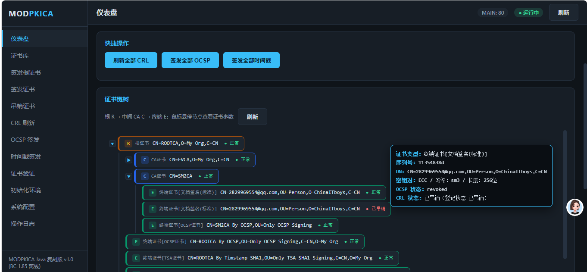
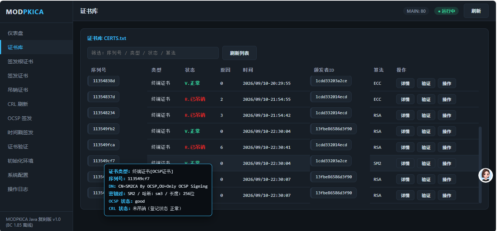
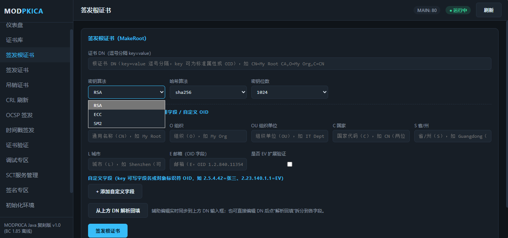
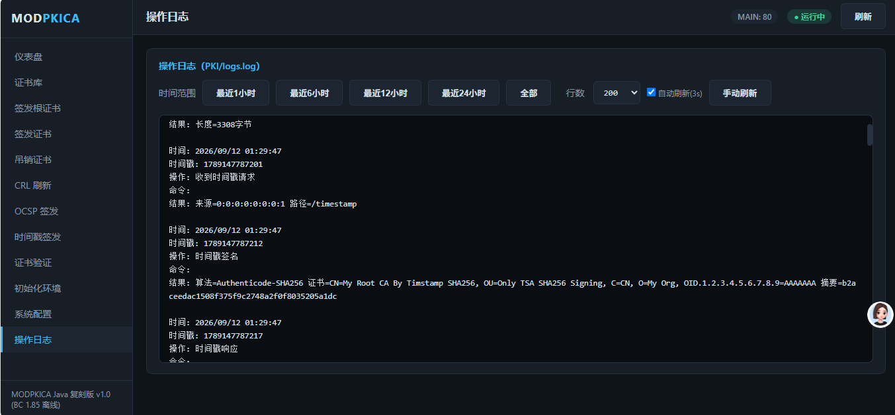
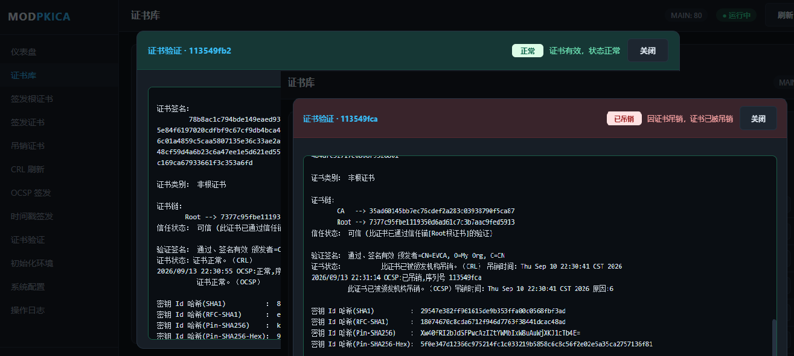

# MODPKICA Java 复刻版 v1.1（BC 1.85 离线）

> 使用 **Java + BouncyCastle 1.85** 离线复刻 Go 版 MODPKICA 全套 PKI 功能：X.509 证书签发、CRL 吊销列表、OCSP 在线状态、RFC3161 / Authenticode 时间戳、WebAdmin 浏览器管理面板。
>
> - **技术栈**：纯 `javac` 编译，无 Maven / Gradle，无网络依赖，离线可开发
> - **依赖**：`BC185/` 目录下 BouncyCastle 1.85 全家桶（bcprov / bcpkix / bcutil / bcmail）
> - **平台**：Windows（build.cmd）/ Linux（build.sh）
> - **作者**：@魔帝本尊（QQ：2829969554）

---

## 更新记录

- **v1.1（2026-09-13）**
  - 修复 SM2 分支 OCSP 吊销响应的 DER 编码错误：`CertStatus.revoked` 由 EXPLICIT 改为 RFC 6960 规定的 `[1] IMPLICIT RevokedInfo`（`OcspUtil.createResponseSm2`）。此前 openssl 解析报 `Field=revocationTime ... wrong tag`、BC 报 `illegal object in getInstance`，表现为 SM2 已吊销证书（含重复吊销/修改吊销原因）验证时输出 `OCSP无法检查吊销状态 | 上报失败~`；修复后 openssl / BC 均能正确解析出吊销时间与原因
  - `build.cmd` / `build.sh` 支持编号参数：`build.cmd 1` ~ `build.cmd 8`，编译成功后自动运行对应编号的启动命令（编译失败则不运行；编号 4/5/7/8 为脚本内置固定示例参数）
  - WebAdmin 证书库美化：类型中文显示（R=根证书 / C=CA证书 / E=终端证书）、状态三色（V 正常绿 / R 已吊销深红 / N 未知橙）、颁发者序列号悬停悬浮窗；每行新增「验证」按钮（弹窗三态：正常/已吊销/未知，对应绿/红/橙配色标题）与「操作」按钮（吊销证书 / 续签证书 / 密钥更换分组，吊销支持下拉选择 + 证书简要信息）
  - `CertVerify` 证书策略识别补充 TSA 证书 OID `2.23.140.1.4.2`

---

## 目录

- [更新记录](#更新记录)
- [功能特性](#功能特性)
- [界面截图](#界面截图)
- [项目结构](#项目结构)
- [环境要求](#环境要求)
- [一键编译](#一键编译)
- [运行方式](#运行方式)
- [命令行用法（7 个主程序）](#命令行用法7-个主程序)
- [WebAdmin 管理面板](#webadmin-管理面板)
- [PKI 目录与文件说明](#pki-目录与文件说明)
- [证书类型与命名规则](#证书类型与命名规则)
- [配置文件 CONFIG.txt](#配置文件-configtxt)
- [登记表 CERTS.txt](#登记表-cerstxt)
- [操作日志 logs.log](#操作日志-logslog)
- [常见问题 FAQ](#常见问题-faq)

---

## 功能特性

### 1. MAIN —— 网络服务主程序

- **OCSP 在线证书状态协议**：`/OCSP`、`/ocsp`（POST），按请求证书序列号查 CERTS.txt 返回正常 / 已吊销 / 未知状态；支持 Nonce、按请求摘要算法自适应（SHA1/SHA256/SHA384/SHA512，SM2 固定 SM3，无摘要默认 SHA1）；未知序列号返回无签名 unauthorized 响应；用 `序列号_ocsp.crt/.key` 签署响应；SM2 分支吊销响应按 RFC 6960 标准编码（`revoked [1] IMPLICIT RevokedInfo`），openssl / BC 均可正常解析
- **CRL 吊销列表下载**：`/CRL/序列号.crl`、`/CRL/序列号.der.crl`
- **证书下载**：`/CRT/序列号.crt`
- **RFC3161 时间戳**：`/rfc3161`（文档签名专用，SHA1 / SHA256 自适应）
- **微软 Authenticode 时间戳**：`/timestamp`（SHA256）、`/timestamp/sha1`（SHA1）；请求体为 base64（容忍 CRLF / 末尾 NUL 等杂字符），响应为 PKCS#7 分离签名（eContent + signedAttrs 含 id-data 属性）
- **自适应根 TSA**：SHA1 → 随机 `rsa_sha1` / `ecc_sha1`；SHA256 → 随机 `rsa_sha256` / `ecc_sha256`；SM3/SM2 → `sm2_sm3`
- **静态网页**：`/` 提供 `PKI/WebPublic` 下文件
- **启动时自动刷新全部 CRL**
- **内嵌 WebAdmin 管理面板**（管理端口见下）

### 2. Admin —— 管理控制台（命令行）

`init` 初始化环境、`makeroot` 签发根证书、`list` 列出证书、`signcert` 签发证书、`revoke` 吊销证书、`signCRL` 刷新 CRL、`initOCSP` 签发全部 OCSP 证书、`initTIMESTAMP` 签发全部时间戳证书、`verifyCERT` 证书验证。

### 3. MakeRoot —— 签发根证书

生成 `ROOT/序列号.crt`、`ROOT/序列号.key`，同步 `WebPublic/CRT/序列号.crt`，登记 CERTS.txt（类型 R）。

### 4. MakeCert —— 签发下级证书

支持签发中间 CA（类型 C）、终端证书（类型 E）；颁发者证书类型自动从 ROOT / CA 目录加载密钥对；支持 RSA / ECC / SM2、SHA1 / SHA256 / SHA384 / SHA512 / SM3；密钥用法、增强型密钥用法（EKU 编号或 OID）、证书策略、SAN、有效期自定义。

### 5. RootGetCrl —— 签发吊销列表

遍历 CERTS.txt 中全部 R / C 证书，为每个颁发者生成独立 CRL（`WebPublic/CRL/序列号.crl`），哈希算法沿用颁发者证书（如 RSA/sha256、RSA/sha512）。

### 6. CertVerify —— 证书验证

输入证书文件或序列号，打印证书全字段（版本、序列号、签名算法、DN、有效期、公钥、SKI/AKI、EKU、SAN、AIA、CRL 分发点、KeyUsage、基本约束、证书策略、扩展、SCT）、签名验证、证书链、CRL + OCSP 吊销状态、各类哈希。

### 7. Auto —— 自动化命令

`init` 初始化环境、`revoke 序列号 原因` 吊销证书、`newcert 序列号 类型 状态 原因 时间 颁发者ID 算法` 手工登记。

### WebAdmin —— 浏览器管理面板

深色主题管理后台（13 个页面），详见下文。

---

## 界面截图

### 仪表盘（证书链树 + 服务状态）

根 R → 中间 CA C → 终端 E 的证书链树，节点悬停显示证书参数；顶部一键刷新全部 CRL / 签发全部 OCSP / 签发全部时间戳；底部最近日志。



### 证书库（CERTS.txt 列表）

序列号 / 类型 / 状态 / 原因 / 时间 / 颁发者 ID / 算法 / 操作，支持筛选与刷新；类型中文显示（R=根证书 / C=CA证书 / E=终端证书），状态三色（V 正常绿 / R 已吊销深红 / N 未知橙）；序列号与颁发者序列号悬停显示证书简要信息；每行含详情 / 验证 / 操作三个按钮（验证弹窗按状态显示绿/红/橙标题，操作含吊销证书、续签证书、密钥更换分组）。



### 签发证书（参数化表单）

证书 DN（key=value 或 OID）、证书类型、密钥算法（RSA / ECC / SM2）、密钥位数（RSA 可编辑 1024~8192，ECC 只读 256/384/521，SM2 只读 256）、哈希算法、KeyUsage（下拉 + 悬浮多选组合）、EKU（编号/OID 悬浮选择器 35 项）、有效期（年数或起止日期，秒级选择）。



### 操作日志（logs.log 可视化）

时间范围筛选（最近 1/6/12/24 小时、全部）、行数设置、自动刷新（3 秒）、手动刷新；每条日志含时间、时间戳、操作、命令、结果。



### 证书链详情（悬停悬浮窗）

证书链树节点悬停弹出详情：证书类型（含策略识别）、序列号、DN、密钥对 / 哈希 / 密钥长度、OCSP 状态、CRL 状态。



---

## 项目结构

```
modpkica4JAVA/
├── BC185/                        # BouncyCastle 1.85 离线 jar 全家桶
│   ├── bcprov-jdk18on-1.85.jar   # 加密 Provider
│   ├── bcpkix-jdk18on-1.85.jar   # 证书 / CMS / TSP
│   ├── bcutil-jdk18on-1.85.jar   # ASN.1 工具
│   └── bcmail-jdk18on-1.85.jar   # 邮件 / SMIME
├── src/modpkica/                 # 全部源码（21 个类）
├── out/                          # 编译输出（javac -d out）
├── build.cmd                     # Windows 一键编译脚本
├── build.sh                      # Linux 一键编译脚本
├── PKI/                          # 运行时数据目录（MODPKICA_BASE 指向项目根时）
│   ├── ROOT/                     # 根证书（类型 R） 序列号.crt / 序列号.key
│   ├── CA/                       # 中间证书（类型 C） 序列号.crt / 序列号.key
│   ├── CERT/                     # 终端证书 PEM（类型 E） 序列号.crt
│   ├── KEY/                      # 终端证书私钥（类型 E） 序列号.key
│   ├── OCSP/                     # OCSP 签名证书 序列号_ocsp.crt / .key
│   ├── TIMSTAMP/                 # TSA 时间戳证书（类型_哈希算法.crt，如 rsa_sha256.crt）
│   ├── WebPublic/
│   │   ├── CRT/                  # 全部证书对外下载目录（序列号.crt）
│   │   └── CRL/                  # 全部 CRL 对外下载目录（序列号.crl）
│   ├── CERTS.txt                 # 证书登记表
│   ├── CONFIG.txt                # 系统配置
│   └── logs.log                  # 操作日志（只追加）
├── a.png ~ e.png                 # WebAdmin 界面截图（本文档配图）
├── README.md                     # 本文件
└── 开发助手_源码分析.pdf          # 源码结构 / 运行流程 / 常量函数速查
```

### 源码类一览（src/modpkica/）

| 类 | 职责 |
|---|---|
| `MAIN` | 主程序 1：HTTP 服务（OCSP / CRL / 时间戳 / 静态网页）+ 内嵌 WebAdmin |
| `Admin` | 主程序 2：管理控制台（doInit / doMakeRoot / doSignCert / doRevoke / doSignCrl / doInitOcsp / doInitTimestamp / doVerifyCert / doList） |
| `MakeRoot` | 主程序 3：签发根证书 |
| `MakeCert` | 主程序 4：签发下级证书（CA / 终端） |
| `RootGetCrl` | 主程序 5：生成全部 CRL |
| `CertVerify` | 主程序 6：证书验证（详情 / 签名 / 链 / 吊销 / 哈希） |
| `Auto` | 主程序 7：自动化（init / revoke / newcert） |
| `WebAdmin` | 浏览器管理面板（8080 管理端口，13 页面，16 个 API） |
| `Bc` | BC Provider 注册 |
| `PemIO` | PEM 证书 / 私钥读写、密钥类型探测 |
| `CertUtil` | 证书构建工具（SKI、扩展组装、私钥读取等） |
| `CrlUtil` | CRL 生成 / DER→PEM |
| `OcspUtil` | OCSP 请求解析 / 响应生成（含 SM2、Nonce、无签名响应） |
| `TimestampUtil` | RFC3161 与 Authenticode 时间戳（含 SM2→SM3） |
| `Sm2Util` | 国密 SM2 签名 / 验签 / SM3 / ZA 计算 |
| `CertsDB` | CERTS.txt 登记表加载 / 查询 / 刷新 |
| `Config` | CONFIG.txt 配置加载 |
| `MLog` | 追加式操作日志（时间 / 时间戳 / 操作 / 命令 / 结果） |
| `AppPaths` | 工作目录定位（环境变量 MODPKICA_BASE） |
| `AppEnv` | 可执行程序清单 |
| `X509JsonConverter` | X.509 证书 → JSON 结构化（证书库详情展示用） |

---

## 环境要求

| 项目 | 要求 |
|---|---|
| JDK | 17+（已装 JDK 17/21 均可），`javac` / `java` 在 PATH 中 |
| 依赖 | 无需联网，`BC185/` 目录内 BC 1.85 四件套 |
| 系统 | Windows 10/11 或 Linux（脚本分别提供 .cmd / .sh） |

---

## 一键编译

### Windows

双击 `build.cmd`，或在 cmd 中执行：

```bat
build.cmd
```

脚本流程：检查 javac → 清理 `out/` → `javac -encoding UTF-8 -cp "BC185\*" -d out src\modpkica\*.java` → 校验 8 个 class（7 个主程序 + WebAdmin）→ 编译成功才打印运行命令提示。

**编号参数（编译后自动运行）：**

```bat
build.cmd [1-8]
```

`build.cmd` 后跟 1~8 的编号，编译**成功后**自动执行对应编号的命令；编译**失败**则跳过，不运行任何命令。编号非法（非 1-8）会在编译前直接报错退出。

| 编号 | 自动运行的命令（等价于手敲 java 命令） |
|---|---|
| `1` | `java "-Dfile.encoding=UTF-8" -cp "out;BC185\*" modpkica.MAIN`（MAIN 服务 + WebAdmin 面板，默认 8080 端口） |
| `2` | `java "-Dfile.encoding=UTF-8" -cp "out;BC185\*" modpkica.WebAdmin`（只开管理面板） |
| `3` | `java "-Dfile.encoding=UTF-8" -cp "out;BC185\*" modpkica.Admin`（交互式管理控制台） |
| `4` | `java ... modpkica.MakeRoot "CN=Root,O=Org,C=CN" 2048 sha256 RSA`（签发根证书**示例参数**） |
| `5` | `java ... modpkica.MakeCert "CN=www.test.com" 2048 sha256 1 1 0 1 "www.test.com" null null root RSA`（签发证书**示例参数**） |
| `6` | `java ... modpkica.RootGetCrl`（刷新全部 CRL） |
| `7` | `java ... modpkica.CertVerify cert.crt`（验证**示例文件** cert.crt） |
| `8` | `java ... modpkica.Auto revoke 1234567890 1`（吊销**示例序列号**） |

> **注意**：编号 4/5/7/8 自动运行的是脚本内置的**固定示例参数**，不会透传额外参数（如 `build.cmd 8 revoke xxx 5` 中的 `revoke xxx 5` 会被忽略）。实际业务参数请改脚本 `:run_4`~`:run_8` 段落，或直接手敲完整 `java` 命令。

### Linux

```bash
chmod +x build.sh
./build.sh        # 只编译
./build.sh 1      # 编译成功后自动运行 MAIN（编号 1-8，与 build.cmd 完全一致）
```

> 编译成功后所有类在 `out/` 目录。

---

## 运行方式

所有主程序统一入口格式：

```bat
set MODPKICA_BASE=你的PKI根目录
java "-Dfile.encoding=UTF-8" -cp "out;BC185\*" modpkica.主程序名 [参数...]
```

> **重要**：Windows 下必须加 `-Dfile.encoding=UTF-8`，否则中文日志 / 中文 DN 乱码（GBK 问题）。
> `MODPKICA_BASE` 缺省时取当前工作目录。示例环境为 `C:\Users\28299\Desktop\modpkica4JAVA`（PKI 目录直接位于其下）。

**运行 MAIN（推荐，WebAdmin 面板随服务自动启动）：**

```bat
set MODPKICA_BASE=C:\Users\28299\Desktop\modpkica4JAVA
java "-Dfile.encoding=UTF-8" -cp "out;BC185\*" modpkica.MAIN
```

- WEB 服务端口：`PKI/CONFIG.txt` 的 `WEBPORT`（默认 80）
- WebAdmin 管理端口：默认 8080；可用系统属性改：`-Dmodpkica.admin.port=8082`
- 启动后浏览器访问 `http://localhost:8080`（管理面板），`http://localhost:80`（WEB 服务）

**只运行 WebAdmin（不启动 MAIN 服务）：**

```bat
java "-Dfile.encoding=UTF-8" -cp "out;BC185\*" modpkica.WebAdmin
```

---

## 命令行用法（7 个主程序）

### Admin（管理控制台）

```bat
java "-Dfile.encoding=UTF-8" -cp "out;BC185\*" modpkica.Admin
```

交互命令一览：

| 命令 | 说明 |
|---|---|
| `init` | 初始化环境（清空证书目录 + 重建 CERTS.txt） |
| `makeroot 证书DN 密钥位数 哈希算法 密钥算法` | 签发根证书，如 `makeroot "CN=Root,O=My Org,C=CN" 2048 sha256 RSA` |
| `list` | 列出全部登记证书 |
| `signcert 证书DN 密钥位数 哈希算法 证书类型 有效期年数 SAN类型 SAN内容 颁发者序列号 密钥算法` | 签发下级证书 |
| `revoke 序列号 原因编号` | 吊销证书（原因 0-9） |
| `signCRL` | 刷新全部 CRL |
| `initOCSP 密钥算法 [序列号]` | 为全部（或指定）R/C 证书签发 OCSP 签名证书 |
| `initTIMESTAMP 哈希算法` | 签发时间戳证书（rsa/ecc/sm2 × sha1/sha256/sm3） |
| `verifyCERT 证书文件或序列号` | 证书验证 |

### MakeRoot

```bat
java ... modpkica.MakeRoot "CN=Root,O=My Org,C=CN" 2048 sha256 RSA
```

### MakeCert

```bat
java ... modpkica.MakeCert "CN=www.test.com" 2048 sha256 1 1 0 1 "www.test.com" null null root RSA
```

### RootGetCrl

```bat
java ... modpkica.RootGetCrl
```

### CertVerify

```bat
java ... modpkica.CertVerify cert.crt        # 按文件
java ... modpkica.CertVerify 113521bfd       # 按序列号（自动去 WebPublic/CRT 查找）
```

### Auto

```bat
java ... modpkica.Auto init
java ... modpkica.Auto revoke 113521bfd 5
java ... modpkica.Auto newcert 序列号 E V 0 null 13fbe86586d1bca RSA
```

---

## WebAdmin 管理面板

启动 MAIN 或 WebAdmin 后，浏览器访问管理端口（默认 `http://localhost:8080`）。

### 页面（13 个）

| 页面 | 功能 |
|---|---|
| 仪表盘 | 服务状态、证书链树（R→C→E，悬停详情、R 展开 / C 收起管理下级）、一键刷新 CRL / 签发 OCSP / 签发时间戳、最近日志 |
| 证书库 | CERTS.txt 列表（类型中文：R=根证书 / C=CA证书 / E=终端证书；状态三色：V 正常绿 / R 已吊销深红 / N 未知橙；筛选、刷新）、序列号与颁发者序列号悬停悬浮窗、详情按钮（JSON 结构化证书信息）、验证按钮（弹窗三态：正常/已吊销/未知）、操作按钮（吊销证书 / 续签证书 / 密钥更换分组） |
| 签发根证书 | 根证书参数表单 |
| 签发证书 | 完整参数表单（DN / 类型 / 密钥算法 / 密钥位数联动 / 哈希 / KeyUsage / EKU / 有效期 / SAN） |
| 吊销证书 | 按序列号 + 原因吊销 |
| CRL 刷新 | 重新生成全部 CRL |
| OCSP 签发 | 为全部 R/C 证书签发 OCSP 签名证书 |
| 时间戳签发 | 签发时间戳证书 |
| 证书验证 | 输入证书文件或序列号验证（证书策略识别含 SSL/代码签名/文档签名/TSA 等 OID） |
| 初始化环境 | 清空重建（不会执行重置类脚本，由 WEB 面板提供） |
| 系统配置 | 可视化读写 CONFIG.txt（WEBPORT / OCSP / CRL / CRT / CPS / CPS_Nonice 多行文本） |
| 操作日志 | logs.log 时间范围筛选 + 自动刷新 |

### API（16 个，均 POST）

`/api/status`、`/api/certs`、`/api/logs`、`/api/config`、`/api/chain`、`/api/certjson`、`/api/version`、`/api/issuers`、`/api/init`、`/api/makeroot`、`/api/signcert`、`/api/revoke`、`/api/crl`、`/api/initocsp`、`/api/inittimestamp`、`/api/verify`

---

## PKI 目录与文件说明

| 路径 | 内容 |
|---|---|
| `PKI/ROOT/` | 根证书：`序列号.crt` + `序列号.key` |
| `PKI/CA/` | 中间证书：`序列号.crt` + `序列号.key` |
| `PKI/CERT/` | 终端证书 PEM：`序列号.crt` |
| `PKI/KEY/` | 终端证书私钥：`序列号.key` |
| `PKI/OCSP/` | OCSP 签名证书：`序列号_ocsp.crt` + `序列号_ocsp.key` |
| `PKI/TIMSTAMP/` | TSA 证书：`类型_哈希算法.crt`（rsa_sha1 / rsa_sha256 / ecc_sha1 / ecc_sha256 / sm2_sm3）+ `.key` |
| `PKI/WebPublic/CRT/` | 全部证书对外下载：`序列号.crt` |
| `PKI/WebPublic/CRL/` | 全部 CRL 对外下载：`序列号.crl`、`序列号.der.crl` |
| `PKI/CERTS.txt` | 证书登记表 |
| `PKI/CONFIG.txt` | 系统配置 |
| `PKI/logs.log` | 操作日志 |

---

## 证书类型与命名规则

| 类型 | 含义 | 密钥存储 | 对外 |
|---|---|---|---|
| `R` | 根证书 | `ROOT/序列号.crt`、`ROOT/序列号.key` | `WebPublic/CRT/序列号.crt` |
| `C` | 中间证书 | `CA/序列号.crt`、`CA/序列号.key` | `WebPublic/CRT/序列号.crt` |
| `E` | 终端证书 | `CERT/序列号.crt`、`KEY/序列号.key` | `WebPublic/CRT/序列号.crt` |
| OCSP 专用 | OCSP 签名 | `OCSP/序列号_ocsp.crt`、`_ocsp.key` | `WebPublic/CRT/序列号.crt` |
| TSA 专用 | 时间戳签名 | `TIMSTAMP/类型_哈希.crt/.key` | `WebPublic/CRT/序列号.crt` |

> 所有证书签发后同时按 `序列号.crt` 同步到 `WebPublic/CRT/`，供 `/CRT/{CID}.crt` 下载。

---

## 配置文件 CONFIG.txt

位于 `PKI/CONFIG.txt`，无文件时 WebAdmin 系统配置页会自动创建默认内容：

```ini
WEBPORT=80
OCSP=http://localhost:80/OCSP
CRL=http://localhost:80/CRL/{CID}.crl
CRT=http://localhost:80/CRT/{CID}.crt
CPS=https://gitee.com/wxgshuju/modpkica
CPS_Nonice=http://example.com/nonice
```

- `WEBPORT`：WEB 服务监听端口（默认 80）
- `OCSP` / `CRL` / `CRT`：写入证书 AIA / CRL 分发点的 URL，支持 `{CID}` 占位符（替换为证书序列号）
- `CPS`：证书策略 CPS URI
- `CPS_Nonice`：证书策略用户通告（UserNotice）文本；WEB 面板多行输入，保存时换行以 `\n` 存储，签发证书时 `\n` 还原为真实换行

---

## 登记表 CERTS.txt

位于 `PKI/CERTS.txt`，每行一条，空白分隔：

```
序列号 类型 状态 原因编号 签发/吊销时间 颁发者序列号 密钥算法
```

示例：

```
13fbe86586d1bca R V 0 2026/09/08-23:18:34 13fbe86586d1bca RSA
113521bfd E R 5 2026/09/09-00:53:25 1cdd332012fa2 RSA
```

- 类型：`R` 根 / `C` 中间 / `E` 终端
- 状态：`V` 正常 / `R` 已吊销 / `N` 未知
- 原因编号：0-9（吊销原因）
- 时间格式：`yyyy/MM/dd-HH:mm:ss`

> MAIN 在 OCSP / 时间戳处理前会重新加载 CERTS.txt，外部修改即时生效（无需重启）。

---

## 操作日志 logs.log

位于 `PKI/logs.log`，**只追加**，每条记录包含：时间、时间戳、操作、命令、结果，记录间以**两个换行**分隔。所有操作（Admin 命令、WEB 请求、CRT/CRL/OCSP/时间戳请求、签名、摘要、验签过程）都会写入。

---

## 常见问题 FAQ

**Q1：编译/运行时中文乱码？**
A：必须带 `-Dfile.encoding=UTF-8` 运行；源码编译已用 `-encoding UTF-8`。脚本注释使用英文避免 cmd 代码页问题。

**Q2：`Address already in use: bind`？**
A：WEB 端口（默认 80）被占用。先 `netstat -ano | findstr :80` 找到 PID 结束旧进程，或改 `CONFIG.txt` 的 `WEBPORT`。

**Q3：OCSP 报"未知序列号"？**
A：确认 CERTS.txt 有记录、`WebPublic/CRT/序列号.crt` 存在、`OCSP/颁发者序列号_ocsp.crt` 已生成（先运行 `initOCSP`）。

**Q4：Wosign 代码签名选 RFC3161 时间戳失败？**
A：RFC3161 时间戳用于 PDF 文档签名；微软代码签名请选 **Authenticode** 类型（`/timestamp` 或 `/timestamp/sha1`）。

**Q5：签发 ECC 证书报错？**
A：确认密钥位数按 ECC 曲线选择（256/384/521），且 BC 1.85 的 `BC185/` 完整放入项目根。

**Q6：SM2 已吊销证书 OCSP 验证报 `OCSP无法检查吊销状态 | 上报失败~`？**
A：v1.1 已修复。根因是 SM2 分支手动 ASN.1 编码 `CertStatus.revoked` 误用 EXPLICIT，RFC 6960 要求 `[1] IMPLICIT RevokedInfo`，导致 openssl / BC 解析错位（`wrong tag` / `illegal object`）。RSA / ECC 已吊销证书不受影响（走 BC 高层 API）。升级后重启 MAIN 生效。

**Q7：如何离线开发？**
A：所有依赖只有 `BC185/` 四个 jar，无 Maven 仓库；源码改完直接 `build.cmd` 编译，`out/` 即产物。
